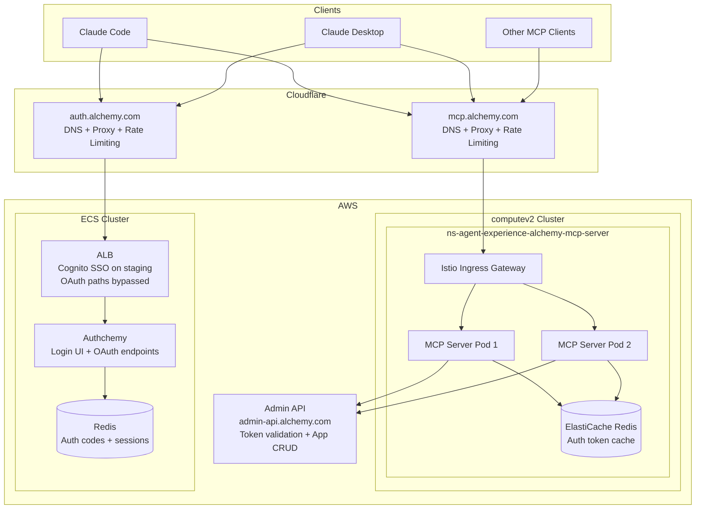
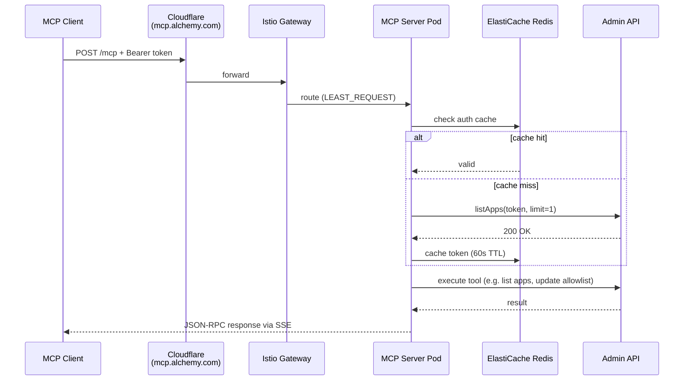
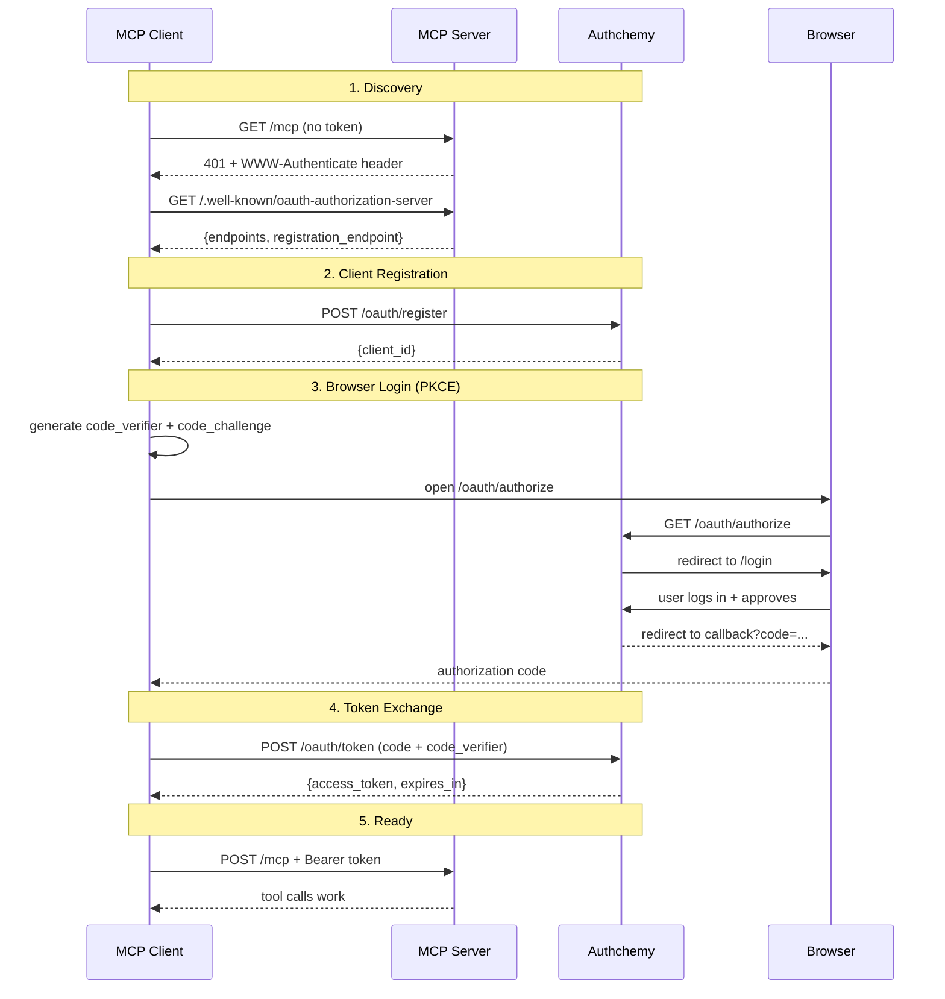

# Alchemy MCP Server — Technical Design Document

## Overview

The Alchemy MCP Server exposes Alchemy's admin APIs as MCP tools, enabling AI clients (Claude Code, Claude Desktop, etc.) to manage apps, allowlists, and chains via natural language. Authentication uses OAuth 2.1 with PKCE, leveraging authchemy's existing login flow.

## Infrastructure Architecture

## Request Flow — Tool Call (Authenticated)

## Request Flow — OAuth Authentication

## Components

| Component | Stack | Role |
|-----------|-------|------|
| **MCP Server** | Node.js / Express on computev2 (Istio mesh) | Stateless MCP endpoint. Serves OAuth discovery metadata, validates tokens via Admin API (cached in Redis), executes tool calls. 2 replicas prod, 1 staging. |
| **Authchemy** | Node.js / Express + Gatsby on ECS | Alchemy's auth service. Handles user login (email/password, Google SSO), session management. New `/oauth/*` endpoints wrap the existing PKCE flow with standard OAuth 2.1 response formats. |
| **Admin API** | Internal service | Alchemy's admin API for app management. MCP server proxies tool calls here. Also used for token validation (`listApps` with limit=1). |
| **Redis (MCP)** | ElastiCache | Caches validated auth tokens (60s TTL) to avoid hitting Admin API on every request. |
| **Redis (Auth)** | ElastiCache | Stores PKCE auth codes (60s TTL) and sessions. |
| **Cloudflare** | CDN/Proxy | DNS, TLS termination, rate limiting for both `mcp.alchemy.com` and `auth.alchemy.com`. |
| **ALB** | AWS ALB | Routes to authchemy ECS tasks. On staging, enforces Cognito SSO with bypass rules for OAuth paths. No SSO on prod. |
| **Istio** | Service mesh on computev2 | Ingress gateway + sidecar proxies for MCP server. Handles TLS, load balancing (LEAST_REQUEST), canary deployments. |

## MCP Server Design

- **Stateless**: Each request creates a fresh `StreamableHTTPServerTransport` with no session ID. Any pod can handle any request — no session affinity needed.
- **Transport**: MCP Streamable HTTP (POST request → SSE response per tool call). No long-lived connections.
- **Auth**: Bearer token validated against Admin API, cached in Redis. OAuth discovery metadata served from the MCP server itself.

## Token Lifecycle

| Phase | Token Type | TTL | Storage |
|-------|-----------|-----|---------|
| **Current** | Auth token as access_token | 90 days | macOS Keychain (Claude Code) / Anthropic servers (Claude Desktop) |
| **Future** | Short-lived access_token | ~1 hour | Client-side |
| **Future** | Refresh token | 90 days | Client-side + DB |

## Security

- **PKCE (S256)** required — no client secrets stored
- **Token validation** on every MCP request via Admin API (cached 60s)
- **Cloudflare rate limiting** on all auth endpoints
- **CSRF exemption** for OAuth endpoints only (no browser sessions)
- **ALB SSO bypass** scoped to exact OAuth paths (`/oauth/authorize`, `/oauth/token`, `/oauth/register`, `/.well-known/oauth-authorization-server`)
- **No public internet exposure** — MCP server behind Cloudflare Zero Trust (WARP required)
